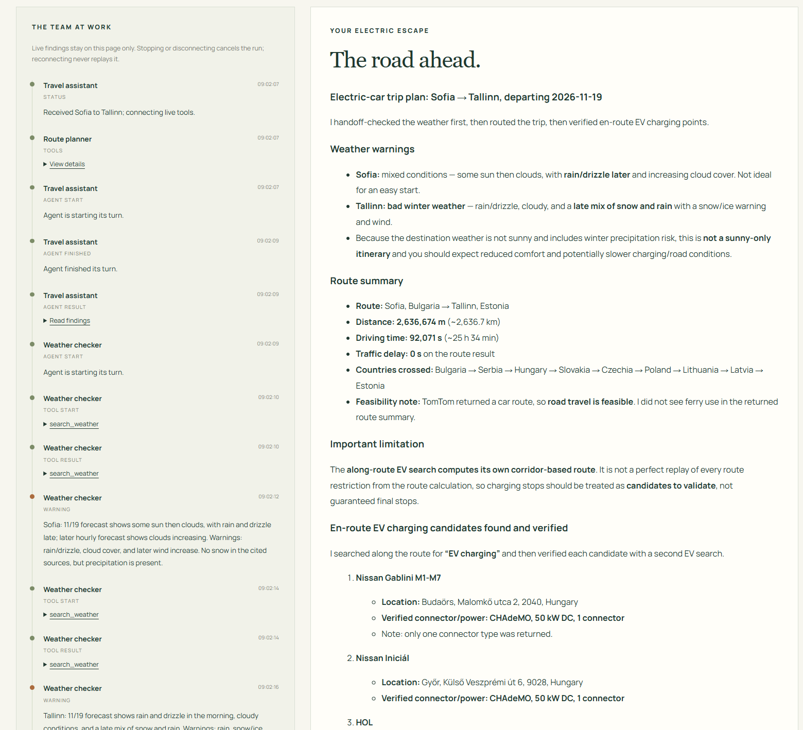
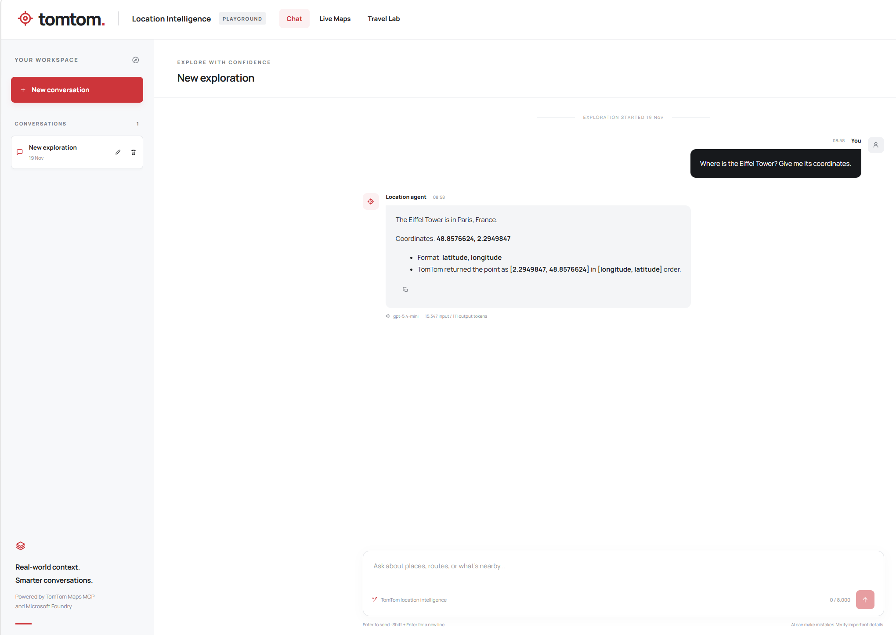
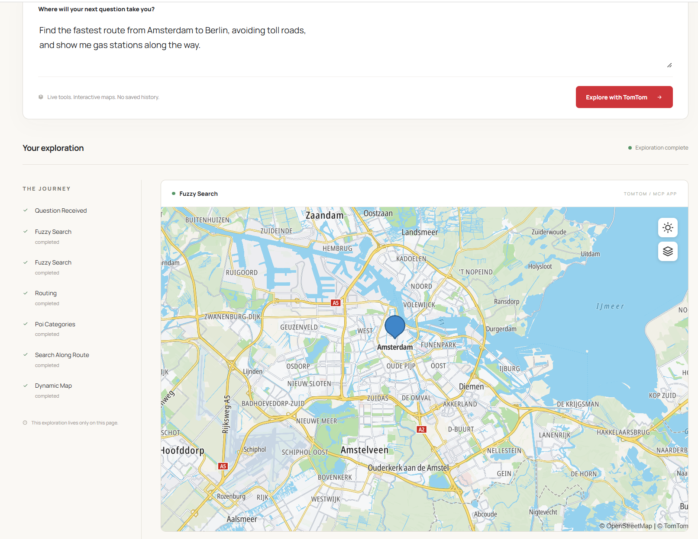

<div align="center">

<samp>LOCATION INTELLIGENCE / LIVE MAPS / MULTI-AGENT TRAVEL</samp>

# 🗺️ TomTom MCP + Microsoft Foundry

**Real-world context. Interactive maps. Agents working together.**

Connect Microsoft Foundry agents to the remote TomTom Maps MCP server,<br>
from a focused C# console sample to a Vue-powered location workspace.

**`.NET 10` · `C#` · `Vue 3` · `MCP over HTTP` · `Agent Framework`**

[Solution preview](#solution-preview) · [Output gallery](#output-gallery) · [Quick start](#quick-start) · [Documentation](#documentation)

</div>

---

## Solution preview

### Travel Lab / Handoff

Watch specialist agents turn a trip request into a weather-aware EV travel plan.
The activity timeline sits alongside the final answer, bringing weather warnings,
route details, and charging candidates into one solution page.

[](images/tomtom-handoff-pattern.png)

*Example output, not a live forecast or a guaranteed itinerary. Charging candidates
require validation; the page surfaces route and weather limitations.*

**Explore the workflow:** [Travel Lab guide](docs/location-intelligence.md#travel-lab-handoff-and-magentic)

## Choose your experience

| Experience | What it demonstrates |
|---|---|
| **Console** | Discover remote TomTom MCP tools, ask one location question, and print a completed answer with Spectre.Console. |
| **[Location Intelligence](docs/location-intelligence.md)** | Vue chat, Cosmos DB sessions, SignalR updates, model/token metadata, Application Insights logging, and WSLC container definitions. |
| **[Live Maps](docs/location-intelligence.md#live-maps-and-mcp-apps)** | Stream a stateless agent's answers and render interactive TomTom MCP Apps for routes and places, without saving results. |
| **[Travel Lab](docs/location-intelligence.md#travel-lab-handoff-and-magentic)** | Real Agent Framework workflows: specialist **Handoff** for weather-aware EV trips and manager-led **Magentic** planning that adapts to sunshine or recommends postponing. Both show live activity, WebIQ forecasts, and TomTom route/charging findings. |

## Output gallery

Two more views of the workspace in action. Select an image to inspect the full-size output.

| Location Intelligence / Chat | Live Maps / Fuzzy Search |
|:---:|:---:|
| [](images/tomtom-conversation.png) | [](images/tomtom-fuzzy-search.png) |
| A location question becomes a tool-backed answer, with conversation history and model/token metadata. | A route-and-stops request produces interactive map output and a visible tool execution timeline. |

**Build these experiences:** [Web workspace setup](docs/location-intelligence.md#run-locally)
· [Live Maps setup](docs/location-intelligence.md#live-maps-and-mcp-apps)

---

## Quick start

**Start with the console sample.** For the screenshot-based web experiences, use
the [web workspace setup](docs/location-intelligence.md#run-locally).

You need the [.NET 10 SDK](https://learn.microsoft.com/en-us/dotnet/core/install/windows),
the [Azure CLI](https://learn.microsoft.com/en-us/cli/azure/install-azure-cli) for the sign-in below,
an interactive terminal, a Foundry project with a tool-capable model deployment and
access permissions, and a TomTom API key enabled for MCP and the APIs you use.
Azure and TomTom usage can incur charges.

After [obtaining your configuration values](docs/environment-variables.md), run from
the repository root in **PowerShell 7.1+**:

```powershell
az login
$env:ENDPOINT = 'https://<resource>.services.ai.azure.com/api/projects/<project>'
$env:DEPLOYMENT_NAME = '<your-model-deployment-name>'
$env:TT_APIKEY = Read-Host 'TomTom API key' -MaskInput
dotnet run --project .\src\TTSLN\TT.Basic\TT.Basic.csproj
```

Replace the placeholders; the endpoint must be a **Foundry project endpoint**, not an
Azure OpenAI resource URL. The sample does **not** load `.env` files.
Press Enter at the question prompt to use the Eiffel Tower example. It prints one
completed answer and exits; there is no chat loop or token streaming.

## Documentation

| Start here | What you will find |
|---|---|
| [Documentation index](docs/README.md) | Choose a guide |
| [Getting started](docs/getting-started.md) | Prerequisites, authentication, setup and first run |
| [Location Intelligence web app](docs/location-intelligence.md) | Vue chat, live MCP Apps maps, configuration, WSLC, Azure ingress and tests |
| [Travel Lab](docs/location-intelligence.md#travel-lab-handoff-and-magentic) | Handoff and Magentic travel scenarios, WebIQ setup, live activity and limitations |
| [Environment variables](docs/environment-variables.md) | Every application variable, value acquisition and optional SDK credentials |
| [Architecture](docs/architecture.md) | Source map, tool execution and lifecycle |
| [Troubleshooting](docs/troubleshooting.md) | Configuration, connectivity and console limitations |

## Official resources

- [TomTom Maps MCP setup](https://docs.tomtom.com/tomtom-maps-mcp/documentation/quick-setup)
  · [Get a TomTom API key](https://docs.tomtom.com/platform/documentation/my-tomtom/how-to-get-a-tomtom-api-key)
- [Microsoft Foundry setup](https://learn.microsoft.com/en-us/azure/foundry/tutorials/quickstart-create-foundry-resources)
  · [Agent Framework Foundry integration](https://learn.microsoft.com/en-us/agent-framework/integrations/by-component/model-providers/microsoft-foundry)
- [C# documentation](https://learn.microsoft.com/en-us/dotnet/csharp/tour-of-csharp/overview)
  · [Spectre.Console documentation](https://spectreconsole.net/console/)

## ⚖️ License

This repository is licensed under the [MIT License](LICENSE).
Third-party packages and hosted services retain their own licenses and terms.
